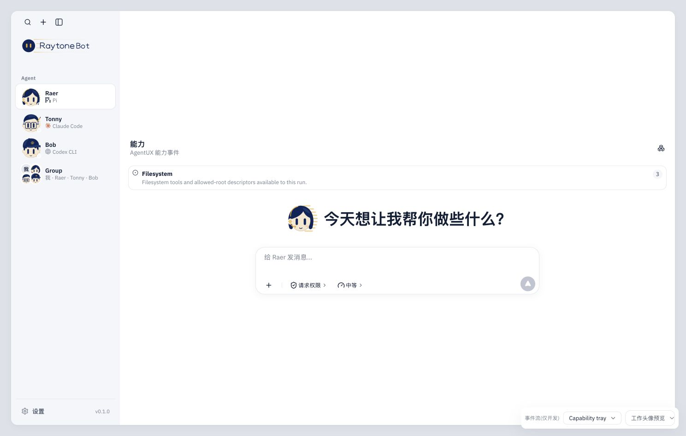
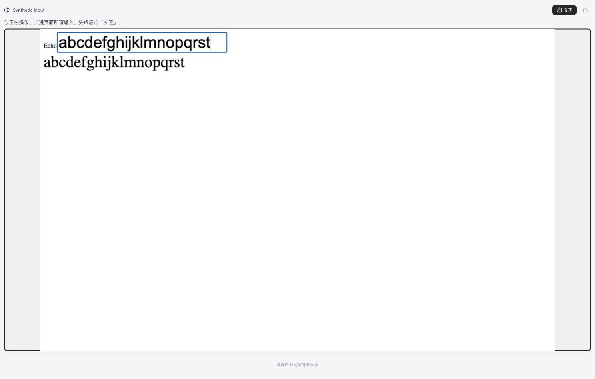

# M5 第一批验收证据 · 2026-10-18

范围仅 sandbox 应用代码及本机隔离验收，未部署，未改外部 Web/control/console、定时唤醒或平台持久权限。当前源码版本见 [source-manifest.json](source-manifest.json)：基于 8037db1 的未提交工作树，不能只用 HEAD 重现。

| 证据 | 结果与边界 |
| --- | --- |
| [全量测试](tests.txt) | 378/378，0 跳过；包含前批修复回归与本批群附件/草稿/产物/真实 Chromium |
| [构建](build.txt) | tsc + Vite 通过；保留原大 chunk 提示 |
| [同版本三引擎](native-engines.jsonl) | 已安装 Pi SDK 1.0.1、Claude Code 2.1.287、Codex CLI 0.162.1；同任务的实际文件/审批/停止/磁盘原生会话续接均成功 |
| [本机接口检查](local-check.txt) | 最终隔离服务：页面、12 工具、空请求及跨源拒绝；无模型请求 |
| [popup 慢下载回归](popup-download.txt) | 原下载页保持打开，切回父标签并由另一轮导航，完成文件仍归原轮；修复前会阻塞旧 CDP detach |
| [19 个 fixture](fixtures.json) | 逐一浏览渲染结果；包含新增三成员 fixture 和 Capability-only 场景；不等于真实任务交互验收 |
| [延迟记录](latency.json) | 本轮较早阶段的有效样本；最终构建复采被浏览器工具超时阻断，不能当最终构建指标 |

## 可重复执行

```sh
npm test
npm run build
node scripts/check-engine-parity.mjs
node scripts/check-browser-latency.mjs
node scripts/check-browser-latency.mjs --slow
RAYTONEBOT_URL=http://127.0.0.1:5194 node scripts/check-local.mjs
```

`check-engine-parity` 使用已安装的真实引擎，模型协议由 loopback 服务提供，MCP 仅受控回调，记忆与文件为真实临时磁盘。重建主机控制器并从磁盘续接原生会话；不是重启整台 sandbox。HTML 后续消息使用与按钮相同文本再发送，未对新生成 HTML 的真实按钮逐引擎点击。临时根目录在脚本退出后删除，不保存凭据或文件内容。

`check-browser-latency` 只在本机起合成站点与现有 BrowserView，独立临时 profile/数据目录/Vite 缓存；普通产品入口不发诊断截图。通过 CUA 在 `/latency?devtools=1` 的现有输入区逐字输入，读取 BrowserView 的 `data-latency-*`；inputId 只关联帧，最多200样本、不保存输入。用显示帧计数等待，不能把 HTTP 回执当完成。测量期间浏览器标签需在前台。

## 未完成的视觉/环境验收

- 真实外部模型与目标 Linux sandbox UID、出站隔离、云端新版本验收；没有部署或变更模型。
- 当前 Chrome 扩展缺少本地文件 URL 权限，文件选择接口拒绝上传；未更改扩展权限。群文本和成员刷新在桌面/390px 已实测，真实 File 字节保存与主机引用权限由测试覆盖，附件上传/刷新视觉项仍待补。
- 新登记 PDF/图片未逐个浏览器视觉复验；文件 API 与预览失败反馈沿用既有验证。
- 后续 CUA 连续超时，最终构建延迟复采未完成。视口 reset 请求未获得回执，无法确认工具已恢复临时390px覆盖。
- 老 Codex 原生会话的 dynamicTools 随创建版本固定，新增登记工具需新建会话。

## 截图

能力托盘复用原组件：



390px 刷新后，Raer/Bob 两位成员和草稿文本保留：


较早人工慢链路采样的实际画面（20次输入后的 Echo）：


