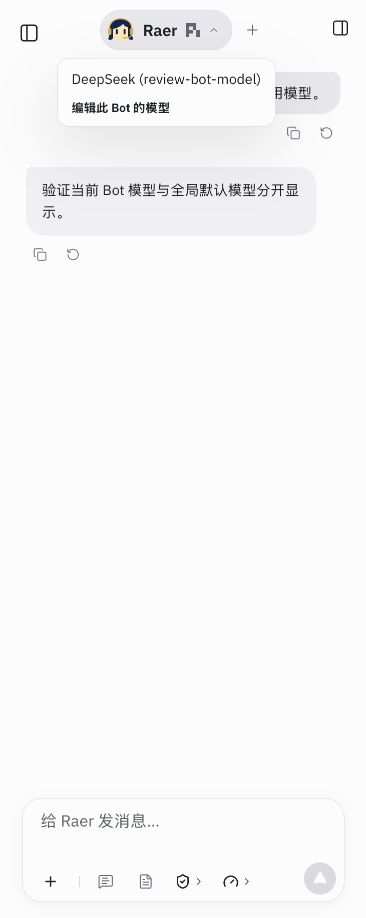
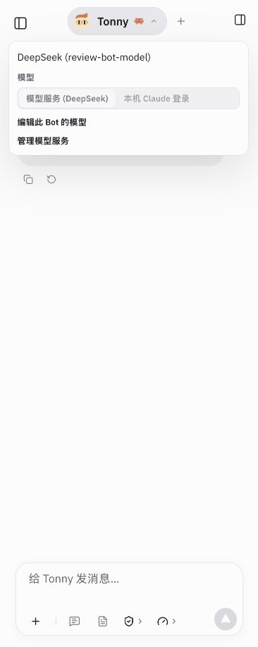

# 2026-10-27 审查修复与文档漂移核对

范围：针对 `am-hosting` 的 `3f797a2` 审查发现，修复五项可复现问题，并以当前工作树代码核对现行文档。沿用单 Node 主机、文件存储、现有组件与工具；产品默认仍为 `deepseek-flash`。没有修改 vendor、引入服务或变更部署。

## 修复结果

| 问题与原行为 | 当前行为 | 回归依据 |
| --- | --- | --- |
| DeepSeek ID 无论填写什么地址，Claude/DSH 都转去官方 Anthropic 地址 | 只转换官方根地址和 `/v1`；显式 Anthropic 端点保留，自定义 OpenAI-compatible 端点拒绝猜测 | [harnessCatalog.test.ts](../../../src/pi/harnessCatalog.test.ts)，先失败后通过 |
| 停用服务仍能被 Bot 覆盖、旧配置或 SDK 默认调用，并取得主机密钥 | 保存的 enabled 在配置、实际执行和凭据读取处复核；停用配置不注册到运行目录，仍允许显式模型列表测试 | [providerStore.test.ts](../../../src/pi/providerStore.test.ts)，真实控制器/存储配受控引擎，先复现实际调用再确认被拒绝 |
| 委派摘要截到 2000 字符，隐藏子会话又不可从普通历史读取，结论无法取回 | `group_tasks({taskId,offset:0,limit:2000})` 返回公共答案页面及 nextOffset；限定当前群、原任务 runId、completed 状态 | [groupDelegation.test.ts](../../../src/pi/groupDelegation.test.ts)，长结论、重启、其他轮次隔离、越界参数、取消输出 |
| 顶栏/Composer 显示和修改全局模型，主机却用 Bot 专属模型 | 有覆盖时显示/提交同一 Bot 模型，菜单保存 Bot revision；无覆盖时沿用入口选择。CLI 来源不会显示成无效的本机登录 | [botProfiles.test.ts](../../../src/runtime/botProfiles.test.ts) 与下方实际 UI 检查 |
| 群重置只清父记录，成员原生上下文仍在 | 锁住父群，逐个重置所属成员及委派会话（含离群成员），最后清父记录；失败拒绝等待中的新轮次 | [groupLifecycle.test.ts](../../../src/pi/groupLifecycle.test.ts)，同时保留 active-run 拒绝、等待与失败回归 |

群重置仍不是跨文件事务：已成功重置的子会话不会因后续失败回滚；父群记录保留，等待请求失败，不自动重放。完整委派输出受原主机输出上限与文件保留条件约束；记录被删除会明确报错。

## 文档漂移对照

核对根 README、产品 01–12、issue 与两条部署 runbook。修正现行说明；带日期的 ADR、验收、调研保留当时结论，必要处补后续说明。

| 旧文档的现行表述 | 源码现状/修正 | 修改位置 |
| --- | --- | --- |
| API key 仅在浏览器内存，刷新需重填 | ProviderStore 加密持久化；浏览器仅有未提交输入，外置私密目录须单独恢复 | [README](../../../README.md)、[产品范围](../../product/01-product-brief.md) |
| Provider 配置以 localStorage 为准、先写浏览器、最后保存覆盖 | 主机 GET/POST、revision/409，成功后页面应用；旧缓存仅作迁移候选，已开页面没有 Provider 轮询 | [架构](../../product/02-architecture.md)、[issue](../../../issue.md)、[Provider 说明](../../product/12-provider-credentials-proposal.md)；依据 [useProviderSettings.ts](../../../src/runtime/useProviderSettings.ts) |
| Bot 名字/头像只在浏览器，其他浏览器恢复默认头像，后台入口使用旧快照 | `bots.json` 是网页/IM/例行任务/群聊共同来源；localStorage 为显示及未提交归属缓存 | [架构](../../product/02-architecture.md)；依据 [botConfig.ts](../../../src/pi/botConfig.ts)、[useBotProfiles.ts](../../../src/runtime/useBotProfiles.ts) |
| 模型标签与选择仍按全局服务理解 | 明确 Bot 覆盖优先级、CLI 来源及停用处理，群路由与成员执行分别说明 | [架构](../../product/02-architecture.md)、[引擎说明](../../product/10-agents-and-permissions.md)，并同步中英日设置文案 |
| 委派只有有界摘要；群重置只描述前台等待 | 补充完整结果分页、可读状态与归属限制、成员/委派会话重置和失败边界 | [架构](../../product/02-architecture.md)、[引擎说明](../../product/10-agents-and-permissions.md)、ADR-055 补充 |
| 浏览器只有 headless shell；工作区和事件链路只列三个引擎 | 默认仍 headless，可选完整 Chromium + Xvfb，部署保留选择；补 DSH 目录与 ACP 链路，仍仅本机 | [引擎说明](../../product/10-agents-and-permissions.md)；依据 [deploy.py](../../../scripts/agentsphere/deploy.py)、[workspaceLayout.ts](../../../src/pi/workspaceLayout.ts) |
| 当前入口日期停在 10-22，功能摘要遗漏新能力，架构靠易过期的源文件行数说明 | 更新当前入口和 T6.4 能力；删除非契约性的行数。普通 ask_user 仍拒绝秘密，登录输入已另有 Vault 专用卡 | [路线图](../../product/03-roadmap.md)、[产品范围](../../product/01-product-brief.md)、[架构](../../product/02-architecture.md) |

部署文档继续保留 AgentSphere 与 AgentMatrix 的不同边界；AgentMatrix 的首个应用响应不代表浏览器、隔离、常驻或完整恢复已验收。未据本机修复改写线上状态。

## 验证

- `npm test`：576/576 通过，0 跳过。包含真实 Chromium 的既有浏览器回归，以及本次增加的服务/模型/群生命周期回归。
- `npm run build`：通过。仍有既有的大型可视化依赖 chunk 超过 500 kB 的提示，没有扩大本次修复去重构依赖。
- `RAYTONEBOT_URL=http://127.0.0.1:5198 npm run check:local`：通过，独立临时数据及角色工作区；`node scripts/cloud-preview.mjs --check`：通过。
- 浏览器：IAB 366px 宽视口实际切换欢迎页和全部 19 个事件场景，日志无 error。打开实际测试聊天，验证 Bot 模型标题、原编辑器入口、修改后更新、Claude 来源固定为 provider。可选 Composer 菜单在测试入口启用，使用同一 AgentApp/主机，确认选择改变 Bot 而不修改全局 Provider revision 或默认模型。
- 模型测试使用受控引擎/本机数据及虚拟凭据；未发送外部真实推理请求，未做云端、真实账号或多模型回答质量验收。界面本次重点为窄屏功能回归，未新增桌面/暗色专项。

以下两张关键截图随本报告保存。其余截图及可选菜单测试入口留在本地 `output/review-fixes-2026-10-27/`，不纳入提交；测试主机和私密临时数据已在验收后清理。188 个本地 Markdown 文件链接检查通过（无新增或既有缺失），`git diff --check` 通过。

