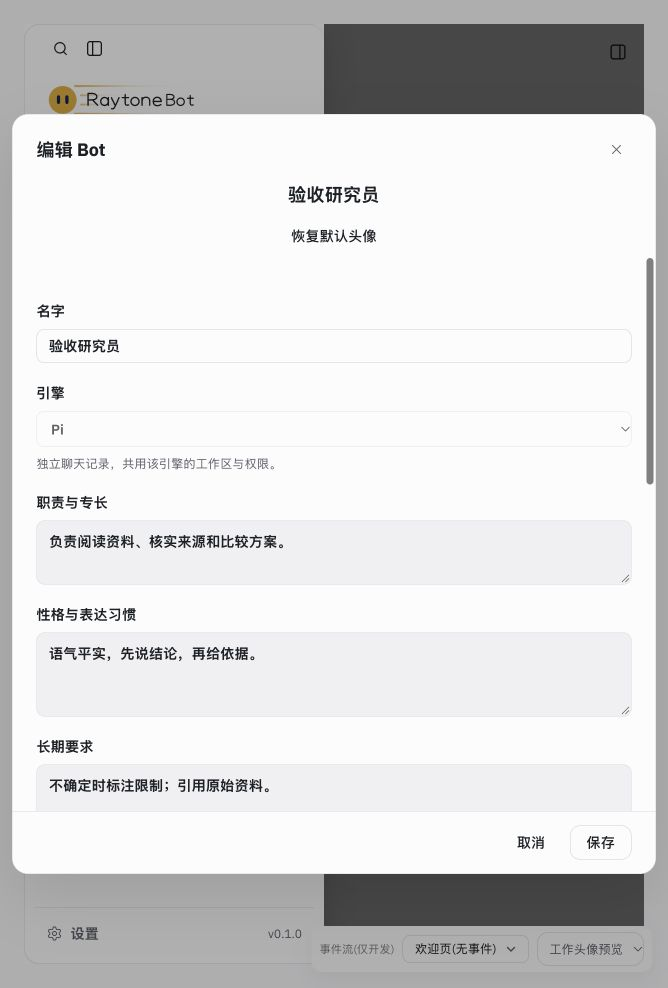
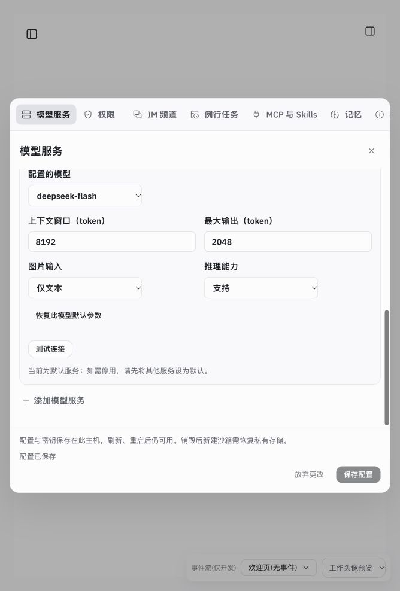
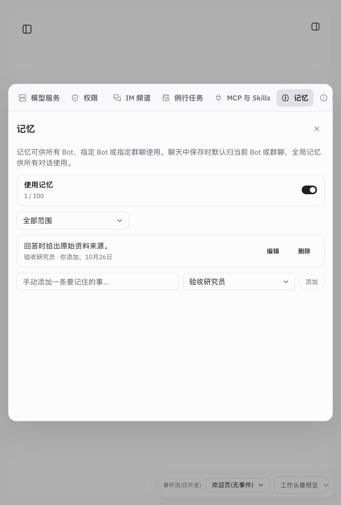
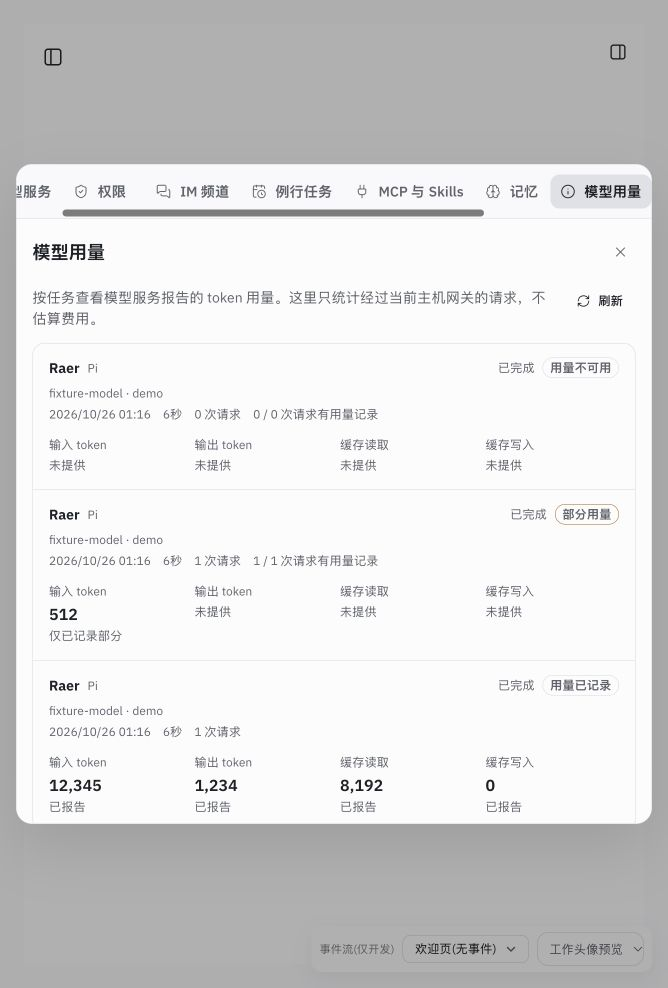

# 独立 Bot 与长期上下文验收

2026-10-26。对应 T6.4、ADR-055。沿现有组件和单个 Node 主机实现；没有新增服务、数据库或依赖。

## 已实现

- 创建／编辑 Bot：职责与专长、性格与表达习惯、长期要求；可选独立模型和 MCP／文本 Skill 分配。保存在主机 `bots.json`，身份不因改名变化。明确选定服务的 Bot 优先使用该服务，未覆盖时保留原入口的模型和 CLI 登录选择。
- Pi 自定义模型：每模型上下文窗口、最大输出、图片输入、推理能力；统一校验、保存、恢复和 SDK 注册。非法输出上限不能保存；移出候选列表的模型参数仍可在编辑器中清除。产品默认模型未修改。
- 全局／Bot／群记忆和 `recall_memories`，旧记录继续全局；当前会话及用户明确引用的历史只读搜索、原文锚点读取。引用最多每轮五个，随草稿、队列和分支保留；已授予的范围可在后续轮次使用。
- 主机文本 Skills 库及按需 `read_skill`；MCP 与 Skill 的分配在实际调用时再次核对。Codex 原生会话固定启动工具列表，新增工具需新会话；撤销的工具不会继续调用。
- 按任务记录网关已报告的 token、缓存明细、耗时和状态；完整／部分／未知分别展示，不推断价格。相同 run ID 在不同对话中的记录保持独立。
- 主持向已加入群成员发起一层只读后台委派，四任务限制、取消、独立结果轮次及重启待核对；沿既有任务 artifact 和历史，不自动重放。

## 自动验证

- `npm test`：570/570，通过、无跳过，见 [tests.log](tests.log)。
- `npm run build`：通过，保留已有 Vite 配置警告和大 chunk 提示，见 [build.log](build.log)。
- 隔离主机 `RAYTONEBOT_URL=http://127.0.0.1:5191 npm run check:local`：通过，见 [check-local.log](check-local.log)。
- `node scripts/cloud-preview.mjs --check`：通过，见 [cloud-check.log](cloud-check.log)。
- `git diff --check`、修改文档本地链接检查：通过。

行为回归使用真实存储与主机、受控 Pi bridge、本地 HTTP 模型端点、已安装的 Pi SDK。SDK 测试确认配置的 `max_tokens` 真正进入请求；非法 metadata 不会先注销原 provider。网关测试覆盖 SSE 分段／Unicode、JSON、断流、背压、重复请求记录、缺失字段和跨对话 ID 冲突。委派测试覆盖前台继续、并发保存、范围、容量、停止、晚到结果、独立通知与重启不重放。

## 实际界面验证

在独立数据目录 `/tmp/raytonebot-enhancements-ui-20261026` 启动验收服务，浏览器实际操作，未修改用户日常数据或密钥：

1. 创建测试 Bot，填写三项人设，刷新后再次编辑，文本恢复；分配独立模型、关闭全部 MCP、选择 Skill 后保存并重新打开核对。
2. 模型参数输入 context=8192、output=16384，保存禁用且显示原因；改为 output=2048、文本输入／支持推理后保存。重启服务后四项恢复。
3. 创建“资料核对”文本 Skill；创建仅属于测试 Bot 的记忆，列表显示归属；设置沿现有样式滚动、固定操作栏可见。
4. 添加“验收资料：方案比较”对话引用，输入草稿后刷新，文本和引用芯片均恢复；可单独移除引用。
5. 用独立 fixture 数据检查用量完整／部分／未知的显示，缺失值显示“未提供”，缓存列不重复计入总输入。截图数值是验收样本，不是真实消费记录。
6. 逐项切换全部 20 个内置场景（含欢迎页）：思考、群聊、审批、工具完成、错误、产物、重试耗尽、终态与中断均有渲染；当前页面控制台无 error。场景清单见 [fixtures.json](fixtures.json)。这是渲染冒烟验证，不代表真实模型自主选择工具的成功率。

## 边界

未调用外部真实模型，未部署 AgentSphere／AgentMatrix，未推送。Bot 人设、记忆和工具范围属于应用层能力管理，同引擎 Bot 仍共用工作区和原权限模型，不是独立 UID／文件系统安全隔离。直接 HTTP 兼容端点、CLI 本地登录、路由／标题请求等不一定经过任务网关，因此用量不是供应商总账。
