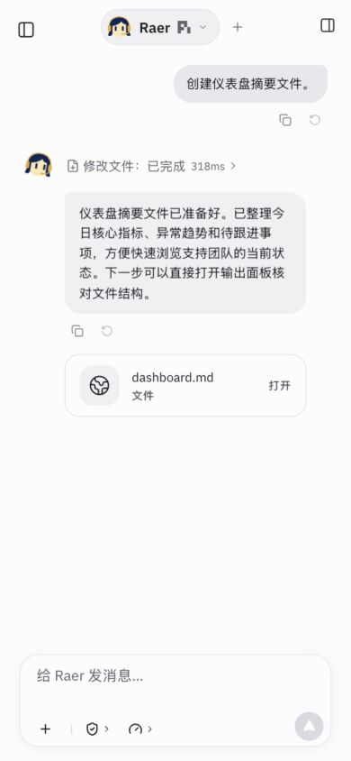
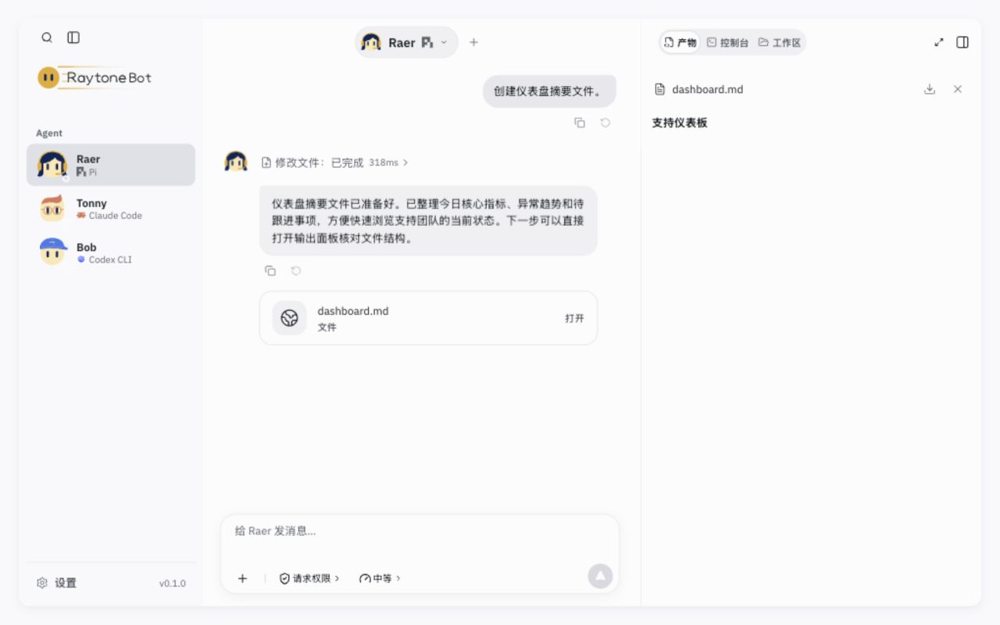

# 聊天标识简化 · 2026-10-28

用户要求去掉用户笑脸、“我”和单聊里重复的 Bot 名字。只修改 `src/exported-project.ts` 已有 `conversation.userAvatar` / `speakerLabels` 两项配置为 false。用户气泡仍靠右，颜色、消息操作、顶部名字保持原样；群聊通过原 `forceLabel` 显示成员名，无新组件或样式覆盖。

验证：

- `npm run build` 通过，保留既有大 chunk 提醒。
- `node --test src/runtime/messageCopy.test.ts src/runtime/toolPresentation.test.ts`：4/4 通过，消息复制、重发/分支可用性与工具生命周期未受影响。
- 隔离端口 5192、临时数据目录，手机 390×844 和桌面 1280×800 实际浏览器检查；未调用模型、未部署。
- 全部 20 个内置场景逐一切换并保存 DOM、截图：用户头像/“我”标签数量均为 0；单聊作者标签为 0；群聊仍有 Raer / Tonny / Bob 三个名字。控制台无 error。见 `fixtures.json`、`fixture-*.png`。
- `git diff --check` 通过。此轮不增加镜像配置实现的测试。

