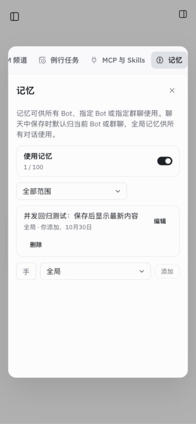
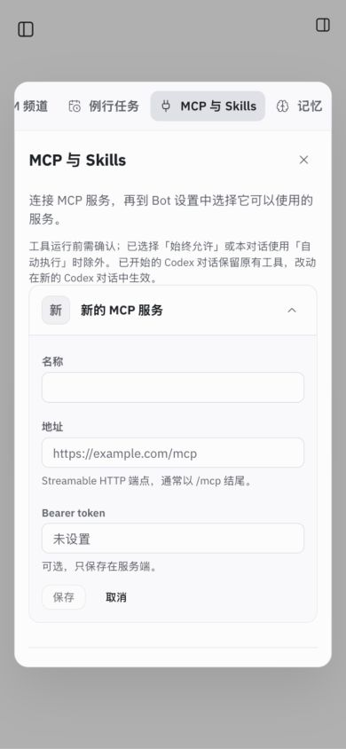

# Gemini review 优先项修复 · 2026-10-30

范围为用户确认的两项“先修”：业务状态码与记忆/MCP 设置竞态。

## 修改

- `ConversationRequestError` 只标记本轮涉及的会话校验与冲突，HTTP 按显式 status 返回 400/409；保留错误文案、现有创建会话行为及其他错误类。
- 两个设置 Hook 在异步请求前同步加锁；写操作使之前的读取失效，迟到成功/失败都不能覆盖当前状态。卸载后的响应不再写状态；成功和失败均释放锁，失败可手动重试。
- 记忆轮询改为读取完成后等待 5 秒再读，避免慢请求重叠。MCP 行与记忆开关在操作中禁用，只有当前保存行显示“保存中”。

## 验证

- 新增 HTTP 测试先因 500 失败，修复后通过：空名单、未知 Bot、重复成员、移除主持均为 400；单聊配置/重置/成员修改与群聊重置冲突均为 409。运行身份不变，非法请求不创建历史，合法名单仍可创建新会话。
- 新增真实 Chromium/React 测试先复现旧数据恢复、旧错误覆盖，修复后通过。测试使用临时 Vite 页面直接挂载生产 Hook 和真实 piClient，仅在 HTTP 边界控制响应；没有模拟 React Hook。覆盖两种设置的迟到成功/失败、重复点击只发一次、保存失败释放锁并可重试，以及慢轮询不重叠。
- `npm test`：624/624，无失败、跳过，见 [日志](tests.log)。
- `npm run build`：通过，现有大 chunk 警告仍在，见 [日志](build.log)。
- 临时数据及工作区、5195 端口：`RAYTONEBOT_URL=http://127.0.0.1:5195 npm run check:local` 通过（UI、Pi SDK、12 工具、空请求 400、跨源 403）。
- `node scripts/cloud-preview.mjs --check`：通过鉴权、Host/Origin、CSRF、内部标准化和 handoff 校验。
- IAB 390×844 实际新增/编辑测试记忆，确认保存结果；MCP 列表与新增表单可用。全部 20 个内置事件场景均无横向溢出，浏览器 error 为 0，见 [逐场景结果](scenarios.json)。

## 边界

未调用真实外部模型、连接外部 MCP 或使用真实凭据；未部署、推送。UI 使用隔离数据；网络竞态由自动化测试控制，不代表外部网络稳定性。最初 IAB 默认宽度为 319px，页面宽度为 320px；改用 390px 验收后无横向溢出，本轮未改布局或最小宽度。
