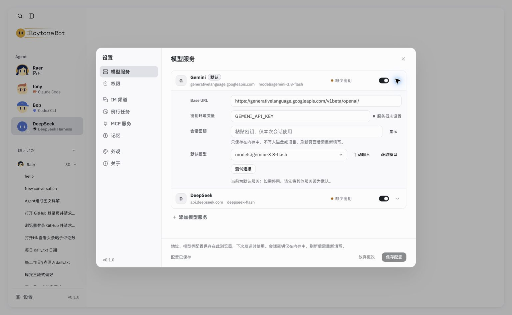

# Gemini 已配置但请求 DeepSeek：实际页面排障

2026-10-23，在用户正在使用的本机 Chrome 页面核对，未重新加载页面，未读取任何密钥值。

- 报错为 `No API key for deepseek/deepseek-flash`。
- 设置页面实际显示 Gemini 已启用、模型已配置，但 DeepSeek 仍有“默认”标记。添加/启用服务不会自动更换默认服务。
- 已按用户使用 Gemini 的意图，在原页面点击 Gemini“设为默认”和“保存配置”；重新打开设置后确认 Gemini 默认标记及已保存状态。保留用户选择的模型 ID，不改为其他模型。
- 当前 Gemini 密钥输入为空，环境变量显示“服务器未设置”。只读主机状态进一步确认 `sessionKeyProviders` 为空且 `envKeys` 不含 `GEMINI_API_KEY`，未输出其他配置或秘密。
- 剩余步骤需要用户在原设置页自行填写 Gemini 密钥并保存。没有凭据，不能完成真实连接或推理验证；没有自动重发用户消息。
- 没有证据支持修改 Pi 模型切换代码。本次只纠正当前浏览器默认服务；配置恢复与原生会话相关测试结果见 tests.log。

