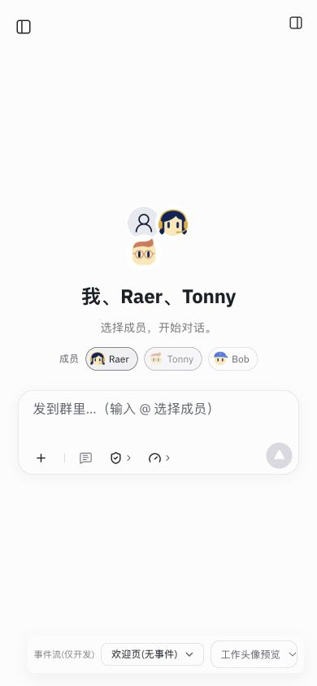
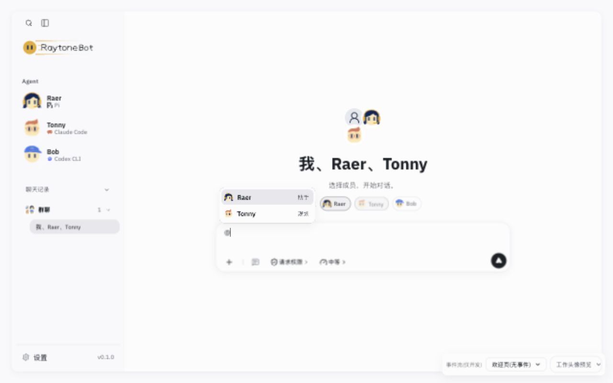

# 群聊欢迎页群主状态修复验收（2026-10-31）

基线：`152593b`。快速子代理（gpt-6-luna）实现，主代理 review、真实浏览器验证与提交。

## 根因与修复

之前已在真实浏览器复现：成员 `[assistant, planner]`、群主 `planner` 时，欢迎页错误禁用首位 Raer，Tonny 却可点击。失败证据见[上一批记录](../slimming-group-view-2026-10-31/README.md)。

`GroupWelcome` 没有接收/传递 `hostId`，内部 `GroupHeader` 因默认参数取了 `members[0]`。聊天头部已正确传入会话群主；服务端也正确拒绝移除实际群主。

修复仅修改 `src/agent-shell.tsx` 和 `src/components/shell/ShellExtras.tsx`：

- shell 向 `GroupWelcome` 传 `activePiConversation.groupHostId`。
- `GroupWelcome` 新增可选 `hostId?: string`，原样传给已有 `GroupHeader`。
- 主代理核对所有调用；`GroupHeader`、服务端群主校验、排序、会话与流式状态机未改。省略 prop 时原默认行为保留；不新增组件或状态。

## 验证结果

| 检查 | 结果 |
| --- | --- |
| 子代理 `npm run typecheck` | 通过 |
| 子代理群成员/提及相关测试 | 7/7 通过 |
| `npm run build` | 通过，原有大 chunk 提示保留；[日志](build.log) |
| `npm test` | 默认并发 646/646，无失败/跳过；[日志](tests.log) |
| `RAYTONEBOT_URL=http://127.0.0.1:53923 npm run check:local` | 通过，无模型调用；[日志](check-local.log) |
| `node scripts/cloud-preview.mjs --check` | 通过；[日志](cloud-check.log) |

未新增自动 UI 测试设施；现有原生 Node 测试不能直接渲染 TSX/CSS 组件，本次使用上轮失败证据和本轮真实 UI 交互验证漏传 prop 的修复。

## 真实浏览器回归

使用临时数据目录与工作区，在新浏览器来源 `127.0.0.1:53923` 验证。首先通过开发场景显示已有聊天头部，使用成员邀请 UI 为 Tonny 邀请 Raer，再切回无事件欢迎页；群元数据来自实际接口，fixture 正文不写入产品会话。

1. 欢迎页 `[Raer, Tonny]`：Raer 可操作，Tonny 禁用。
2. 点击 Raer：成功移除首位非群主，标题变为“我、Tonny”；Tonny 仍禁用。
3. 重加 Raer 并刷新：Raer 已选且可操作，Tonny 仍禁用；`@` 候选为 Raer、Tonny。
4. 390px 窄屏保持同样禁用状态；逐项切换全部 20 开发场景，无横向溢出，19 个事件场景均挂载聊天框。
5. 控制台 warn/error 为 0。交互状态和场景快照见 [browser-results.json](browser-results.json)。临时持久化的成员、实际群主与事件数（0）见 [stored-group-check.json](stored-group-check.json)。

初始端口 5197 的浏览器缓存含先前测试草稿，发现后关闭页面并改用新来源；不清理原缓存、不发送草稿。一次侧栏定位等待失败是视口收窄后入口隐藏，观察状态后固定桌面测试尺寸继续。上述验证辅助问题未修改产品代码。

验证结束后关闭自建浏览器页、恢复视口，停止自建服务并删除临时数据。未调用真实模型，未部署或推送；自定义 Bot 和无 `hostId` 的旧数据兼容性仅核对类型/默认参数，未另做浏览器场景。

