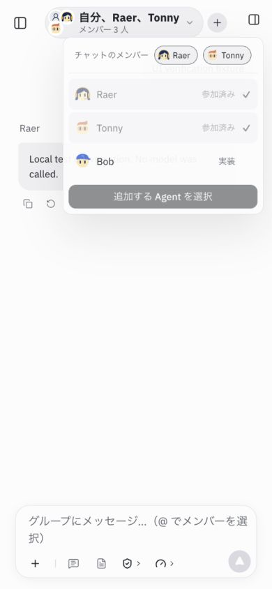
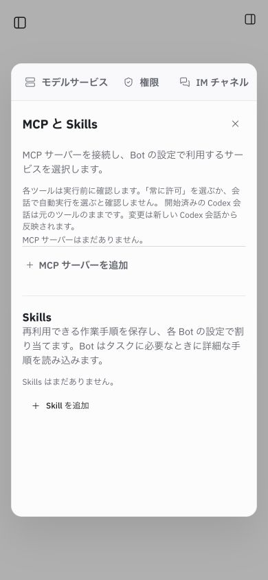
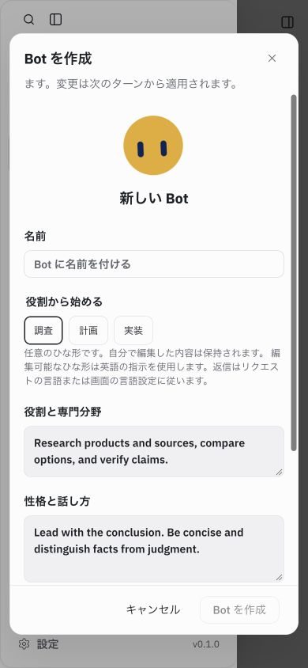
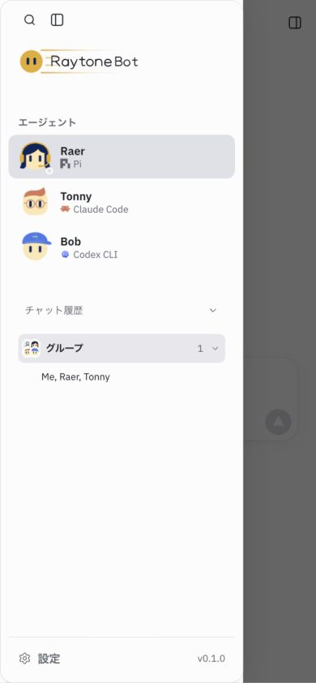

# 国际化与回复语言 · 2026-10-30

## 修改范围

- 补齐现有群聊、Bot 编辑、模型参数、Skills、记忆、RSL、例行任务、产物搜索、文档操作、表单校验和配置续接的中文、英文、日文文案。共享文案进入 `src/i18n/copy/features.ts`，原有字典继续沿用；不增加 UI 面板或服务。
- 群头像用人物图标代替固定“我”；默认成员列表名随界面语言显示。保留 `titleSource` 和 `group.preserveTitle`，用户标题、模型标题、聊天内容与用户人设不翻译。
- 语音识别从固定 `zh-CN` 改为当前界面语言。
- 系统、群聊路由与分工指令使用英文；可编辑 Bot 职责模板使用英文并在界面说明。统一回复优先级为明确指定语言、当前用户输入语言、语言不明时的界面设定。无界面设定时参考会话语言或长期偏好。
- Pi、Claude、Codex、DSH 与 Pi 插话共用规则；群介绍及委派携带原始用户请求，FAQ 菜单标签按当前界面语言。模型语言注记不写入产品转录。

## 验证

- 原语言规则的回归先失败，再修改实现。完整 `npm test`：627/627，通过，无跳过，见 [日志](tests.log)。包括真实 React/Chromium 设置竞态测试和受控主机测试。
- 语言回归验证显式语言与输入优先、纯链接/代码等兜底契约、四引擎系统说明、IM 无界面语言、插话只投递一次且原始转录不带注记、日文问候、三语群任务确认映射稳定成员 ID、三语表单错误保留原始字段名。提示断言验证输入契约，不代表模型实际输出已验证。
- `npm run build` 通过；现有大 chunk 警告仍在，见 [构建日志](build.log)。
- 隔离数据/工作区，5195 端口：`RAYTONEBOT_URL=http://127.0.0.1:5195 npm run check:local` 通过，见 [本机检查](local-check.log)。`node scripts/cloud-preview.mjs --check` 通过，见 [云入口规则检查](cloud-check.log)。
- 实际 IAB：中英日切换；390×844 日文 MCP/Skills 新建表单、记忆、RSL、Bot 英文模板；英文与日文群成员菜单、输入提示和默认群名；将群显式命名为 `Me, Raer, Tonny` 后，在日文界面刷新仍保持英文原文。
- 全部 20 个内置事件场景在日文窄屏逐项切换，页面宽度与 scrollWidth 均为 390，浏览器 error 为 0；[逐场景记录](scenarios.json)。最后针对头像和标题来源再检查群聊显示。

## 边界

合成群消息明确标记为 UI 测试数据；没有调用真实外部模型、读取真实凭据或发送用户消息。模型语言遵循率和真实麦克风识别未验证。第三方服务/引擎的未知诊断保留原文，未尝试翻译用户内容。没有部署、提交或推送；验收页及临时服务在完成后关闭。
