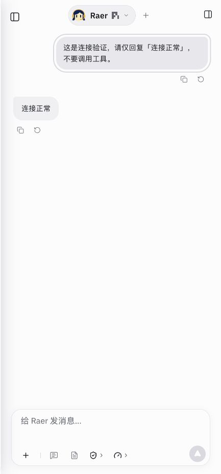

# 本地真实服务恢复与 AgentSphere 部署（2026-10-30）

## 本地问题与处理

5194 是 `output/task-flow-2026-10-29/serve.mjs` 的验收服务，注入固定回复引擎；配置 API 不能改变其模型行为。这是验收入口留存造成的误导，不是供应商 API 调用失败。

已将该演示期间的会话/工作区与加密 Provider 存储私下保存至主机恢复目录，权限收紧为 0700/0600；没有把密文、主密钥或密码放入仓库。确认演示与正式主机保存的 DeepSeek 凭据一致，保留正式配置，不迁移虚构任务。关闭 5194，运行标准 `npm run dev`，使用 [5188 真实入口](http://127.0.0.1:5188/)，原本地历史与草稿保留。

真实 API 检查：`deepseek / deepseek-flash` 完成新验证轮次，回复“连接正常”，0 次工具调用，成功终态；[结果](local-model-check.json)。`check:local` 通过。浏览器已实际打开该会话。

## 演示入口保护

- 默认拒绝启动固定回复服务，必须显式 `RAYTONEBOT_ENABLE_TEST_ENGINE=1`。
- HTML 标题与常驻状态条明确注明“验收演示、固定回复、不调用模型 API”，指向标准 5188 入口。
- 演示拒绝保存 Provider，返回 409；不回显提交内容。
- 手动检查未显式启用时启动失败、显式启用后的状态条及 Provider 保存拦截均通过，测试服务验收后关闭。正常应用没有引入演示引擎，生产 bundle 不含固定回复字符串。

## Sandbox

原实例 `id705on7k0a1ya1d90icj` 从暂停恢复后，在其 control 所属状态目录执行 backup，再运行现有 `deploy.py`。未新建或销毁实例；保留会话/工作区、Provider 加密目录、原有模型环境凭据和访问密码，交接状态沿 control 记录恢复。

- 应用代码：`3fa24de`，本机构建通过；上传约 7 MiB，锁文件更新后执行 `npm ci`。
- [Sandbox 入口](https://5188-id705on7k0a1ya1d90icj.agentsphere.run)。既有访问认证继续有效，不在报告中展示密码。
- 部署脚本通过：认证页面、未认证/错误密码拒绝、health/state、sandbox 模式、分角色工作区、跨源拒绝及无令牌交接拒绝；原生隔离边界检查通过。
- Pi、Claude Code 2.1.267、Codex CLI 0.154.0 检出可用；DSH 继续仅支持本地。本次未对 Claude/Codex 各发真实模型任务。
- 真实 `deepseek / deepseek-flash` 验证完成，回复“连接正常”，0 次工具调用；[结果](sandbox-model-check.json)。这项与部署脚本的 HTTP 自检分别执行。
- 常规数据备份已保存于主机私有部署状态目录（约 202 MiB），不提交到 Git。未改变备份不包含 Provider 私密目录的既有边界；同实例部署未替换该目录。

本轮生产运行时代码未改变；变更仅为验收脚本防误用、经验与部署记录。`node --check`、演示保护检查、本机接口、云入口规则检查与构建通过；没有为文档/验收脚本重复全量模型或 UI 回归。既有 614 项提交前回归见[复审记录](../premerge-review-2026-10-30/README.md)。
