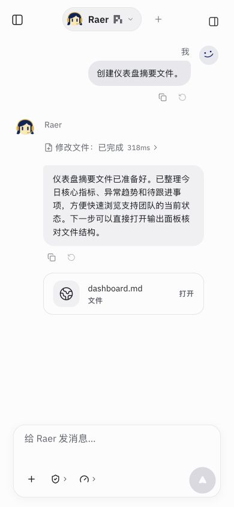
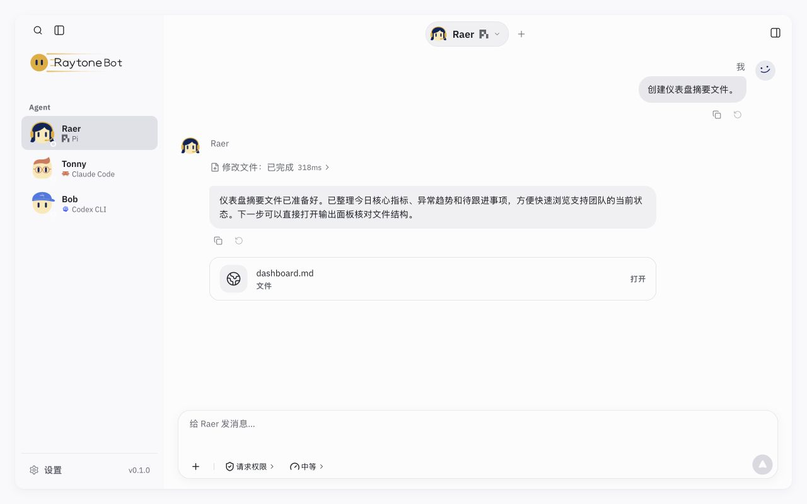

# 手机 / PC 网页操作体验验收 · 2026-10-28

本机代码已实现，未部署、推送或打包客户端。使用独立端口 `5192`、临时数据/工作区/Vault；没有调用外部模型，没有清除用户浏览器数据，保留已有未提交改动。

## 改动

| Before | After |
| --- | --- |
| 844×390 横屏被旧 `min-height:900px` 撑高，输入区超出屏幕 | 产品 shell 独立使用可视区域高度；设置弹层一起适应键盘，保留双指缩放，触屏考虑左右安全区 |
| 长草稿撑高输入区；短屏侧栏品牌行被压扁 | 输入框限高并内部滚动；会话、搜索、侧栏、设置限制纵向滚动传递；侧栏标题不压缩，短屏可滚动 |
| 手机 Enter 直接发送；Safari 中文输入法结束组合时存在误发路径 | 主要输入设备为触屏时 Enter 换行；桌面 Enter 发送、Shift+Enter 换行；两端 Ctrl/Cmd+Enter 发送；`isComposing` / keyCode 229 均不提交或选中 @ 候选 |
| 触屏输入区按钮高 28–34px | 主要输入操作达到 44×44px；侧栏搜索/展开与设置关闭/分区扩大；聊天、搜索和设置输入使用至少 16px 字号 |
| 抽屉焦点仍在触发器，Tab 穿过遮罩；两层 visibility 动画导致首次 focus 失败 | 打开聚焦内部，背景 inert，Tab 首尾循环；Esc 返回入口；搜索、设置各自处理键盘；从抽屉打开设置后关闭返回可见入口；移除重复过渡，保留减少动画偏好 |
| 搜索依赖点击，关闭总回侧栏按钮 | Ctrl/Cmd+K 打开现有搜索，Esc 返回原编辑位置；不抢占设置等弹层；title 与 aria-keyshortcuts 提示快捷键 |

沿用 AgentShell、ComposerFrame、SessionSidebar、SettingsDialog；新增逻辑位于 `src/runtime/`，无依赖、接口、模型或后端变更。

## 自动检查

- `npm run build`：通过，保留原有大 chunk 提醒。
- `npm test`：592/592 通过，无跳过；新增 2 项按键回归，覆盖触屏/桌面、修饰键和 IME。
- `RAYTONEBOT_URL=http://127.0.0.1:5192 npm run check:local`：通过，无模型请求。
- `node scripts/cloud-preview.mjs --check`：通过。
- `git diff --check`：通过。

输出见 `build.log`、`tests.log`、`check-local.log`、`cloud-check.log`。

提交前复验：从暂存区导出独立源码，仅包含本次 UI 改动，排除工作区另行进行的 Bot/例行任务/产物管理变更。生产构建与 578/578 测试通过，见 `commit-build.log`、`commit-tests.log`。上方 592 项结果记录的是开发时完整工作区，二者范围不同。

## 浏览器实测

- IAB Chromium，320×568、390×844、768×800、844×390、1280×800：页面未溢出，输入区底部在视口内，触屏主要操作控件至少 44×44。数据与截图见 `layouts.json`、`layout-*.png`。
- 320px 填写 30 行长草稿，输入框内部滚动，发送与工具栏保持可见：`mobile-long-draft.png`。
- 拦截本地表单 submit，阻止事件到达 React 提交入口：触屏 Enter 插入换行且计数 0；Ctrl+Enter 计数 1；桌面 Enter 计数 2；Shift+Enter 和 keyCode 229 均不增加计数。没有模型请求，随后刷新清除拦截。
- Cmd+K 打开搜索；Esc 后原 textarea 重新聚焦。设置内 Cmd+K 不打开搜索。
- 抽屉自动聚焦、首尾 Tab 循环、Esc 返回、搜索 Esc 只关闭搜索、从抽屉打开设置后关闭回可见入口均实测。减少动画模式下抽屉 `transitionDuration=0s`。
- CDP 临时覆盖 VisualViewport height=460、offsetTop=24 并触发 resize：shell 顶部 24、底部 484，发送底部 364；设置顶部 40、底部 468。模拟 scale=2 后高度变量保持 460，避免缩放重排。见 `viewport.json`；刷新已清除覆盖。这是事件/布局模拟，不是真实软键盘验收。
- 390×460 审批场景中，审批选项、确认按钮和输入区同时可见：`approval-compact.png`。
- 亮/暗主题、手机与桌面截图保存在本目录。全部 20 个场景逐一通过 UI 切换，覆盖欢迎页、思考、工具、审批、错误、重试、耗尽、终止、中断、产物与群聊；见 `fixtures.json`、`fixture-00.png` 至 `fixture-19.png`。最终控制台 error 为空。
- 浏览器视口、触摸和减少动画模拟已恢复；事件追踪、表单拦截、视口覆盖均已刷新清除。

## 限制与依据

未测试真实 iOS Safari / Android 软键盘、刘海安全区与系统手势；未测试 PWA 安装或客户端；不以 fixture 结果声明真实 Agent 或云端部署通过。页面内改进已完成，真机触感需要设备补验。

实现参考 [MDN VisualViewport](https://developer.mozilla.org/en-US/docs/Web/API/VisualViewport)。最终行为以源码和上述浏览器记录为准。

