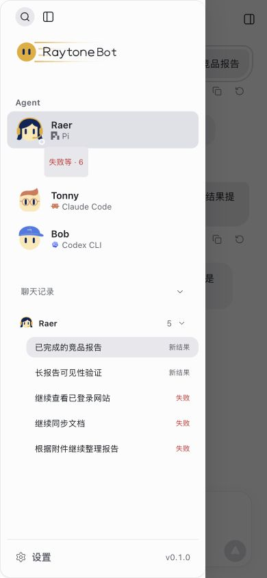

# T6.8 提交前审查（2026-10-30）

基线 `7c85bfa`；范围为竞品复评和 T6.8 配置续接/交付提示。用户授权复审后提交到 main。共享文件按内容暂存，再导出不含 RSL 的暂存树独立验证。审查期间，独立任务已把 RSL T6.9 提交为 `36f2a8c`；本次保留该提交，并补验组合后的工作树，不在本提交重复纳入 RSL。vendor 保持原文件，仅为干净快照补齐既有被忽略构建输出；运行依赖复用现有 node_modules。

## Standards

按 AGENTS.md、05-ai-workflow、现有组件所有权、审批与不自动重放边界审查。发现并修复：

- 工具已成功重试，旧连接错误仍显示继续入口：现在仅在相同工具和参数有后续成功结果时清除旧错误。普通完成回复仍可保留未解决的登录问题。
- 手机抽屉/Bot 编辑器遮挡聊天时仍可误标已读：在现有可见性边界暂停观察，恢复后按真实阅读位置标记。
- 漏跑去重补查遇到损坏历史会拒绝 tick：按任务捕获、记录 `routine.clock_history_failed` 并跳过未知判定，继续其他任务，不补跑。

## Spec

对照 03-roadmap T6.8 与竞品复评优先级 1–2。发现并修复：

- 跨窗口的旧结果可以覆盖新结果已读：保存并合并已查看的结果身份集合，兼容旧单值格式；同时间/缺时间/主机时钟回拨均不会撤销其他结果的已读。
- 已成功工具重试仍触发继续入口：同 Standards 第一项。
- 外部调度已接受的定时场次仍可能误报漏跑：计时检查核对持久 occurrence/turn 身份，跳过已接受场次；未接受的较早场次仍可记录。

两轴原始发现分别为 2 和 3 项（工具重试为共同项）；修复复核再发现 1 项损坏历史保护问题，已修复。最终复核无剩余阻断项。没有扩展审批权限、默认模型、布局或服务。

## 验证

- 独立暂存快照：`npm test` **604/604**，无失败/跳过，见 [输出](tests.log)；`npm run build` 通过，保留既有 Vite 警告，见 [输出](build.log)。
- 保留 main 的 RSL 独立提交后，组合工作树 **614/614** 测试及构建通过，见 [测试](combined-tests.log)、[构建](combined-build.log)。两次验证范围不同，不把测试数当作通过率变化。
- 相关回归 **37/37**：routines、conversationStore、taskRecovery、conversationActivity、useAttentionRead，见 [输出](targeted.log)。已观察原失败再修复，不以静态代码匹配代替行为断言。
- 真实 SDK 主机、临时数据与工作区在 5197 执行 `check:local`：独立快照与组合工作树均通过，不调用模型，见 [快照](local.log)、[组合](combined-local.log)。`cloud-preview.mjs --check` 通过。
- 同一暂存快照的实际应用/HTTP/存储 + 受控引擎在 5196 检查 20 个 fixture，宽度 1280，均无横向溢出及浏览器 error，见 [逐项状态](fixtures.json)。390×844 手机抽屉遮挡期间结果完成仍显示新结果；关闭并看到末尾后清除，见截图。
- 文档本地链接、暂存差异空白与内容范围检查通过。此前真实点击的附件/草稿/双击/审批证据见 [T6.8 记录](../task-flow-2026-10-29/README.md)。

没有真实外部模型、第三方登录、MCP 服务、真实手机或云端部署验收；本次没有推送远端。当前分支本来就是 main，因此通过复核后直接提交 main，不制造额外合并提交；RSL 保留为 main 上的前一个独立提交。
