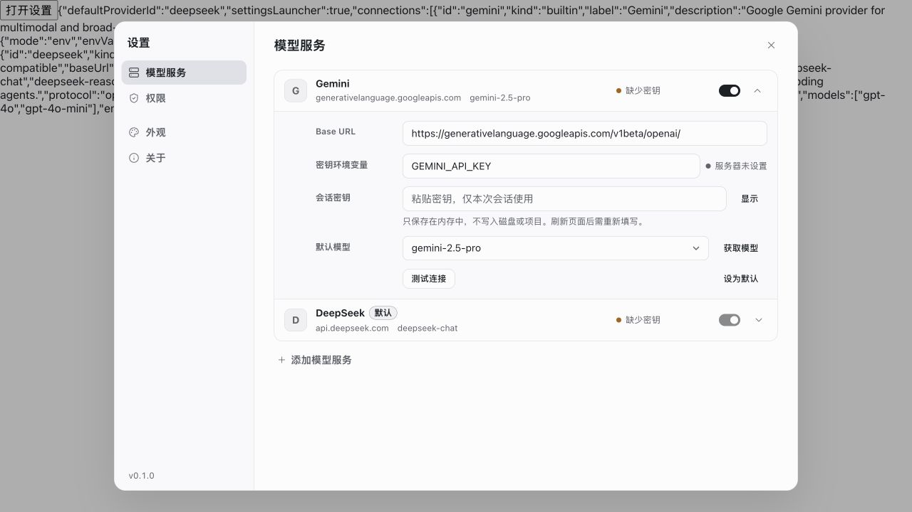
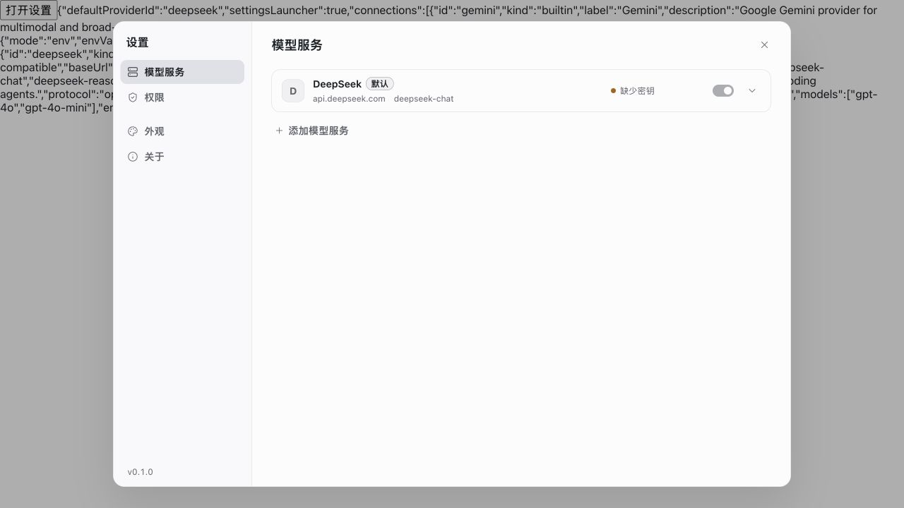
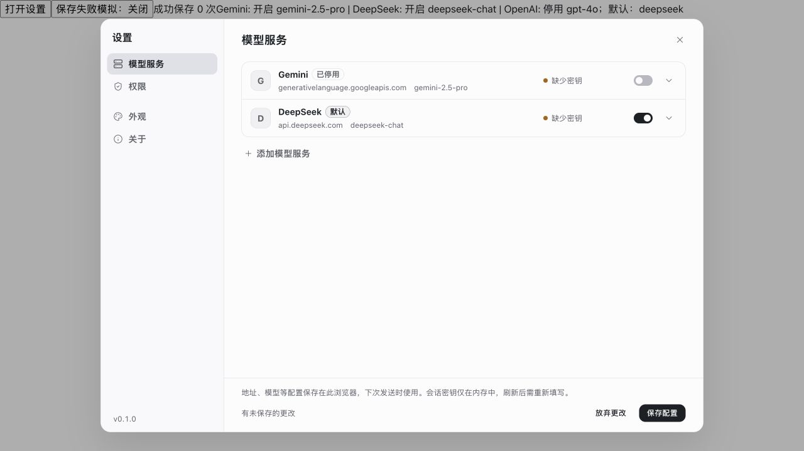
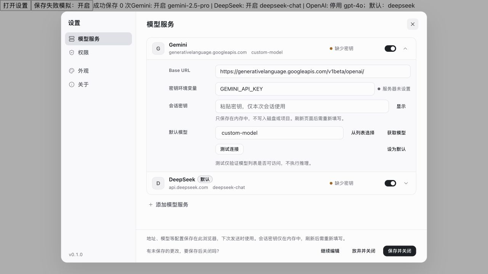
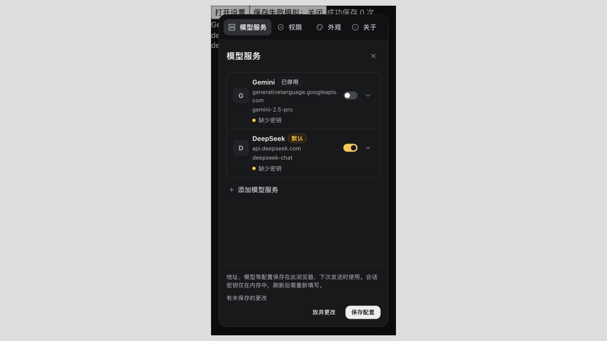

# Provider UI/UX 检查与修复

2026-10-23。本次目标：配置可明确保存和放弃；停用保留服务；开关视觉表达真实状态；模型可选或手输。沿用生产 SettingsDialog、SelectMenu、Switch 和主题，不新增设置面板。

## 逐步检查

1. **查看服务——已修复。** 原界面以 enabled 过滤列表，停用即消失；默认服务 checked=true 但 disabled 样式降低透明度，看似关闭。现在 added 与 enabled 分开，停用行保留并显示“已停用”；开启跟随主题（亮色黑、暗色金黄），关闭灰色。默认服务不能直接停用，提示先更换默认；开关具有约 44px 点击区域。
2. **编辑配置——已修复。** 地址、默认服务、模型和会话密钥先进入草稿。模型支持列表与手输 ID；地址、模型、环境变量校验直接标记字段及底部原因。无效输入不再静默恢复成旧值。测试连接只验证模型列表；获取模型更新候选但保留选择。
3. **保存或放弃——已修复。** 固定底部提供“保存配置 / 放弃更改”。保存先写浏览器存储，再应用本页配置；写入失败保留草稿并允许重试，保存中防止重复编辑，运行中禁止提交。旧探测在保存/放弃后作废，避免重新创建已放弃的草稿。
4. **离开与恢复——已修复。** 未保存关闭时在原底栏显示继续编辑、放弃并关闭、保存并关闭。失败不关闭。保存停用配置后刷新，服务仍保留。保存前发生外部配置变化时报告冲突，避免覆盖新值。
5. **窄屏与暗色——已验证。** 390px iframe 使用真实媒体查询，内容独立滚动，底栏可见；开关、徽标和按钮在暗色下仍能区分状态。桌面沿用左右设置导航及原有信息层级。

## 整体健康与剩余边界

- 主路径的状态反馈、恢复能力和开关语义已补齐；现有控件、布局和主题可继续使用，无需重做整个设置系统。
- **保存范围仍是本浏览器非秘密配置。会话密钥只在内存，刷新会丢失。** 页脚明确说明。Keychain/云端加密存储、主机统一凭据状态、endpoint 绑定和显式删除仍按[密钥方案](../../docs/product/12-provider-credentials-proposal.md)待实现，不能把本次“保存配置”视为密钥持久化完成。
- `/models` 可访问不保证推理、工具调用及各引擎协议可用。本次没有调用真实供应商或执行收费推理。
- 关闭保护针对设置弹窗；浏览器整页刷新/关闭仍会丢弃未提交草稿。非秘密配置仍不跨设备同步。

## 本轮截图

修复前无保存按钮，默认开关灰色：

修复前停用 Gemini 后整行消失：

修复后停用保留、开关区分、固定保存栏：

未保存关闭保护与手动模型输入：

390px 暗色：

截图在本次工作中实际操作并保存，已检查保存后的像素。页面上方工具条属于隔离验收夹具，不是产品 UI。

## 验证与证据

- `npm run build` 通过：[日志](build.log)。保留既有 Vite 配置及 chunk 大小警告。
- `npm test`：457/457 通过，0 跳过：[日志](tests.log)。新增配置停用/恢复、旧格式兼容、草稿校验和提交规范化的回归。
- `npm run check:local` 通过：[日志](check-local.log)。
- `node scripts/cloud-preview.mjs --check` 通过：[日志](cloud-check.log)。
- 20 个内置场景逐项切换，页面宽度均为 1280px，无浏览器 error：[结果](fixtures.json)。此项是渲染冒烟回归，不等于真实引擎端到端测试。
- 隔离浏览器验证：关闭保留行、保存后刷新恢复、重新启用、更换默认、放弃恢复、无效模型阻止保存、模拟保存失败与重试、未保存关闭提示、8 秒迟到探测被丢弃、模型菜单及暗色窄屏。
- [夹具](preview.tsx)直接渲染生产 SettingsDialog；网络响应与保存失败可控。`?persist=1` 使用真实配置序列化/恢复函数，但只写独立测试 sessionStorage 键 `raytonebot.provider-uiux-verification`。未操作真实 provider 配置或用户密钥。当前夹具随生产源码更新，不代表修复前源码快照。
- 相关文件 `git diff --check` 通过。未部署、提交或推送。
