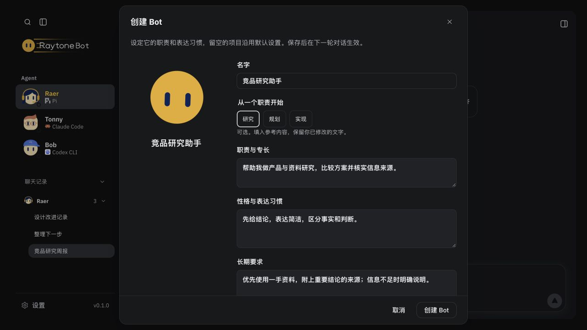
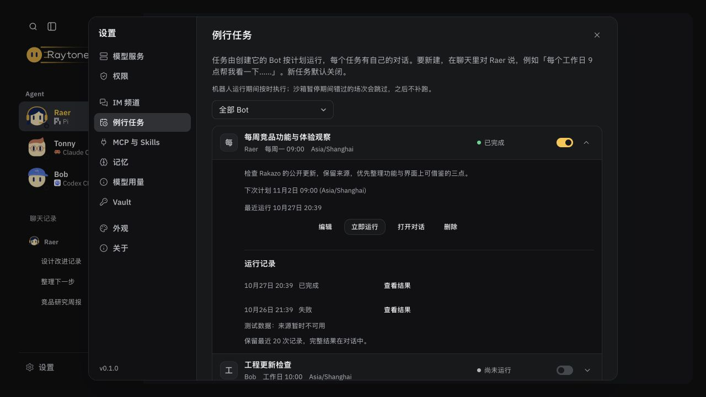
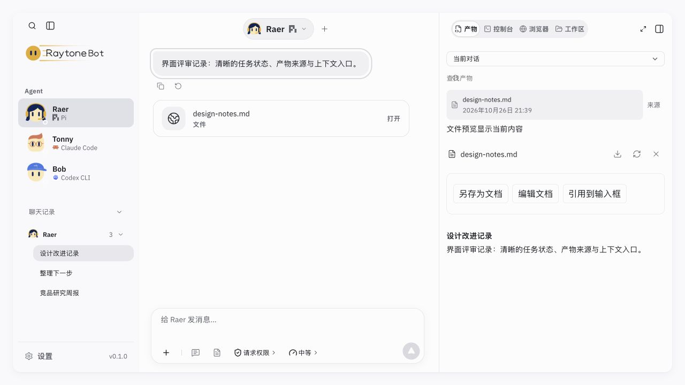
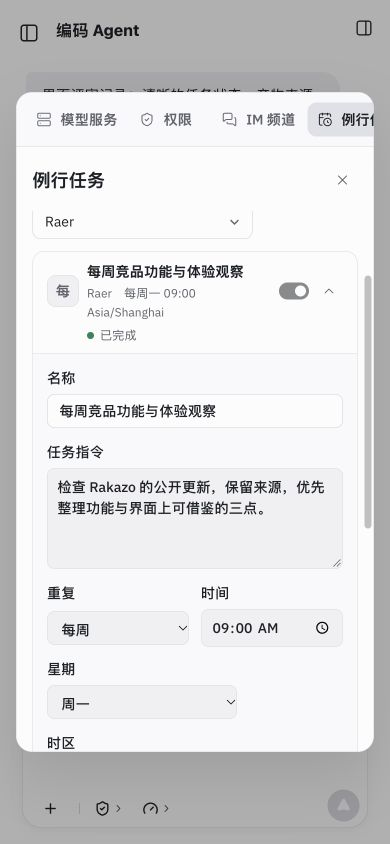
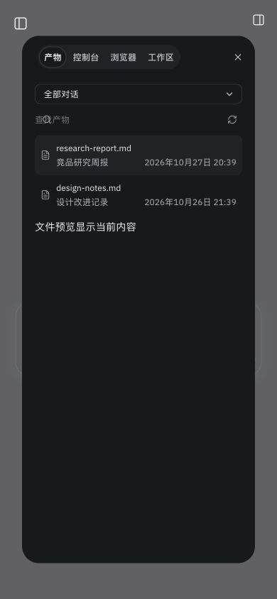

# Rakazo 建议落地验收 · 2026-10-27

本机实现，未部署或推送。使用 `127.0.0.1:5191`、临时数据目录和独立工作区；没有调用外部模型，也没有修改真实账号、生产任务或工作文件。

## 结果

- Bot 创建提供研究、规划、实现起点，只替换空白或未改写的模板文字；高级配置和外观折叠。顶栏直接进入 Bot 编辑、该 Bot 的记忆或例行任务。
- 原例行任务设置支持修改名称、指令、重复规则和时区；revision 冲突保留草稿，运行中拒绝改定义。显示下次计划、最近 20 次状态和可定位结果。
- 原产物页签支持当前/全部对话查找，显示实际时间和来源。来源跳转采用精确回放身份；缺失记录明确提示，缺失文件沿用不可用预览。文件显示当前内容，不提供历史文件快照。
- 保留 ADR-043：执行中工具原位，整轮结束后摘要，详情在右侧控制台；没有改 ChatFrame 或工具收敛逻辑。

## 自动检查

| 检查 | 结果 |
| --- | --- |
| `npm run build` | 通过；Vite 保留既有大 chunk 提醒 |
| `npm test` | 590/590 通过，0 跳过 |
| Bot/例行任务/时区/产物定向回归 | 35/35 通过，包含模板保护、旧版本冲突、运行去重、DST、恢复、文件边界、分支回放身份与扫描预算 |
| `RAYTONEBOT_URL=http://127.0.0.1:5191 npm run check:local` | 通过；UI、SDK、12 工具、空 prompt 与跨域拒绝，无模型请求 |
| `node scripts/cloud-preview.mjs --check` | 通过；鉴权、Host/Origin、CSRF 与交接 |
| 文档相对链接及 `git diff --check` | 通过 |

命令输出见同目录 `build.log`、`tests.log`、`focused-tests.log`、`check-local.log`、`cloud-check.log`。

## 实际浏览器走查

- 创建 Bot、填入模板、改写职责后切换模板，手写文字保留；创建→编辑→刷新恢复成功。高级配置沿原表单。
- 顶栏记忆入口的筛选和新建范围均为 Raer；例行任务入口只显示 Raer，普通设置仍能显示全部 Bot。
- 任务非法时区阻止保存；有效修改保存并刷新恢复；下次计划按 Asia/Shanghai 显示。模拟另一页面提交定义后，旧编辑返回冲突并保留草稿；关闭/重开设置和切换分区仍保留。
- 运行记录定位正确回复；过期记录打开来源对话并提示不可用。测试记录是本地合成内容，不是外部模型执行证据。
- 产物搜索时保留原预览；跨对话点击后正确切换对话、预览并重置筛选。390px 下目录→来源预览只保留一个弹层。
- 1280×720 亮/暗主题、390×844 窄屏实看。修正了窄屏任务标题被状态和开关挤窄的问题。临时视口已恢复。
- `?devtools=1` 全部 20 个选项逐一选择并保存截图、DOM 结果（`fixtures.json`、`fixture-00.png` 至 `fixture-19.png`）；覆盖思考、工具、审批、错误、重试、耗尽、终止、中断与产物。控制台无 error。

## 界面证据

## 边界

历史产物查询限 1000 个对话、20 万事件、2000 个候选，达到上限或历史损坏时明确提示。只有已注册工作文件进入目录，非产物文件仍从工作区打开。例行任务最多计算未来 366 天的下一场；主机休眠不运行、不补跑；未做真实定时唤醒、外部模型或云端部署验收。新的文件/配置格式保持兼容旧记录。
