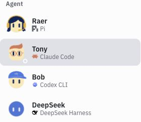

# 移除 Bot 汇总卡片（2026-10-30）

用户明确要求删除截图中的「新结果 · N / 失败等 · N」独立卡片。这些来自 T6.8 新增的跨会话汇总，旧会话首次计入未查看导致大批提醒。

已删除 AgentSwitcher 的 attention prop/渲染、shell 的 Bot 聚合与传递、全部 shell-agent-attention 样式；源码中无相关残留。沿原组件移除，不新增提示或替代卡片。

构建及 614/614 测试通过，见 [构建](build.log)、[测试](tests.log)。真实本地 Bot 列表检查卡片数量为 0；20 个内置场景无卡片、横向溢出或浏览器 error，见 [状态](scenarios.json)。没有新增与实现结构镜像的测试。

已用现有 control 所属状态更新原 sandbox，部署前确认无运行任务，沿用既有数据/凭据；部署自检通过。线上实际 CSS 与本机构建字节一致，且不含该卡片样式，见 [校验](sandbox-check.json)。本轮只做 UI 移除，没有重新调用真实模型。
