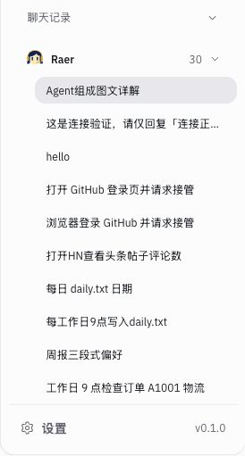

# 撤回会话交付标签（2026-10-30）

前一轮只删除了 Bot 汇总卡片，遗漏同一功能在聊天记录上的“新结果”标签。本次完整撤回这一套展示，而非批量把旧记录标记已读。

删除会话标签及专用布局、汇总/已读计算、可见性观察器、浏览器已读存储代码、无调用方的结果摘要元数据和后台任务轮询；恢复原会话行点击与例行任务设置入口。配置续接、真实运行/审批和服务端任务记录保留。

`src/` 中已无“新结果”、`session-attention`、`useAttentionRead`、`conversationActivity` 等相关展示/计算。没有添加替代标签或提示。

- `npm run build` 通过，见 [输出](build.log)。
- `npm test` 610/610，无失败/跳过，见 [输出](tests.log)。被删除的功能及其 4 项专用测试一起移除；不减少其他功能测试。
- `check:local`、`cloud-preview.mjs --check` 通过，未调用真实模型。
- 实际历史列表无结果标签；20 个内置场景无标签、横向溢出或浏览器 error，见 [检查](scenarios.json)。
- 确认 sandbox 空闲后用既有 control 状态重新部署，自检通过；线上 CSS 与本地构建一致，结果摘要 `activity` 已移除，见 [校验](sandbox-check.json)。
