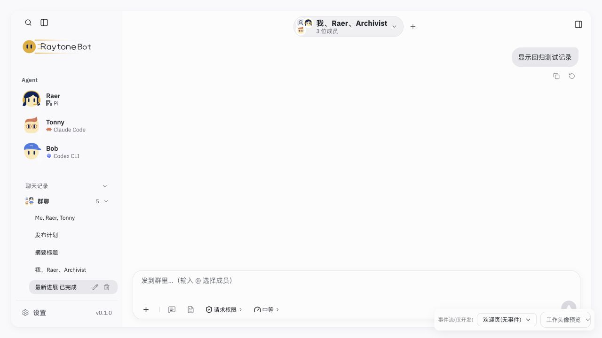
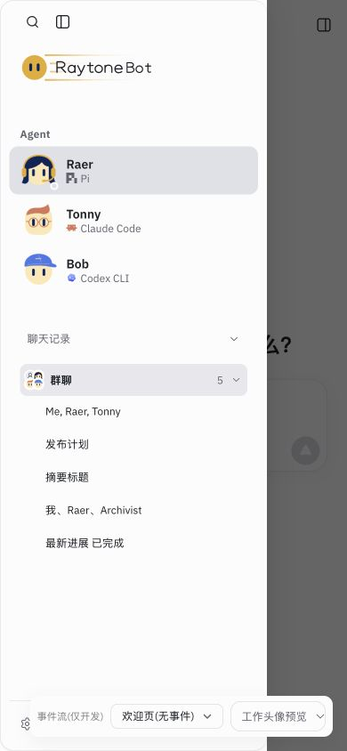

# 群聊标题、预览与头像提取验收（2026-10-31）

基线：`a097103`。快速子代理（gpt-6-luna）实现，主代理独立 review、验证和提交。

## 改动与兼容性

- `src/agent-shell.tsx` 1,905 → 1,896 行；现有 `src/runtime/groupConversationView.ts` 16 → 55 行，新增 `groupConversationTitle`、`groupConversationPreviews`、`groupConversationFaces`。
- shell 保留 `knownBots`、`activeBot`、`presetBot` 与 `PRESET_AVATARS`；向纯函数传名字/角色解析函数及配置，标题保留一个薄接线以维持原调用点。
- 保留当前配置名 → 当前会话成员名 → ID 的标题优先级；预览仍按 `presetBot` 当前名字或默认角色名识别自动标题。手工标题、摘要标题、保留标题、普通会话不被覆盖。头像保持成员顺序/重复以及原过滤和回退规则。
- 26 个原有函数、34 处 effect/memo/callback、三段身份解析、欢迎页/聊天头部/提及 UI 接线与基线逐字一致；会话和流式状态机未改。

主代理直接提取基线中的三个实际表达式，与新函数比较。1,440 个会话组合 × 3 种 locale 得到 4,320 次标题对照，预览/头像合计 2,880 条映射对照，无差异且输入未修改。覆盖成员缺失、非法 ID、重复、自定义 Bot、历史名字、标题来源/保护、不同语言、预览缺失与空白文本。

复核命令：`node output/slimming-group-display-2026-10-31/review.mjs`。脚本及结果：[review.mjs](review.mjs)、[review.json](review.json)。

## 命令验证

| 命令 | 结果 | 证据 |
| --- | --- | --- |
| `node --test src/runtime/groupConversationView.test.ts` | 子代理 8/8；其中本批新增 4 项 | 完整测试日志亦包含这 8 项 |
| `npm run build` | 通过；保留原有大 chunk 提示 | [build.log](build.log) |
| `npm test` | 默认并发 650/650，无失败/跳过 | [tests.log](tests.log) |
| `RAYTONEBOT_URL=http://127.0.0.1:55172 npm run check:local` | 通过，无模型请求 | [check-local.log](check-local.log) |
| `node scripts/cloud-preview.mjs --check` | 通过 | [cloud-check.log](cloud-check.log) |

## 真实浏览器验证

使用独立临时数据目录、工作区和端口 55172。[准备脚本](seed-browser-data.mjs) 通过现有 store 与 adapter 生成五份已结束的合成测试记录；不导入开发 fixture，不访问产品数据或模型。历史列表会过滤事件数为零的记录，因此脚本使用一条合成用户消息和结束事件。

五份记录的群成员均包含默认 Raer 与只在历史记录中存在的自定义 Bot `Archivist`（planner 角色）；历史中的 Raer 名为 `Historical Raer`，当前配置的 Raer 名字应优先。

| 记录 | 页面结果 |
| --- | --- |
| 旧英文自动成员标题 + 带换行/多空格的预览 | 侧栏显示 `最新进展 已完成`；提示和群聊头部显示 `我、Raer、Archivist` |
| 同样的旧自动标题，无预览 | 显示 `我、Raer、Archivist` |
| 用户命名 | 保持 `发布计划` |
| 摘要命名 | 保持 `摘要标题` |
| `preserveTitle: true` | 保持 `Me, Raer, Tonny` |

桌面检查五个标签、群聊头部名字及组合头像；刷新后群聊分组默认折叠，展开后五个标签均一致。原始记录保留了折叠时不可见和展开后可见的结果，未把折叠计为产品失败。窄屏抽屉可正常显示这些记录。

390 × 844 逐项切换全部 20 个开发场景：19 个事件场景均挂载聊天框，全部场景无横向溢出，控制台 warn/error 为 0。结果见 [browser-results.json](browser-results.json)。语言转换、空白预览、成员重复等边界由纯函数测试和基线对照覆盖；未逐一做 UI 场景。

验证后关闭自建浏览器页、恢复视口、停止测试服务并删除临时数据。未调用真实模型、未部署或推送；合成记录展示不能替代真实模型流式验证。
