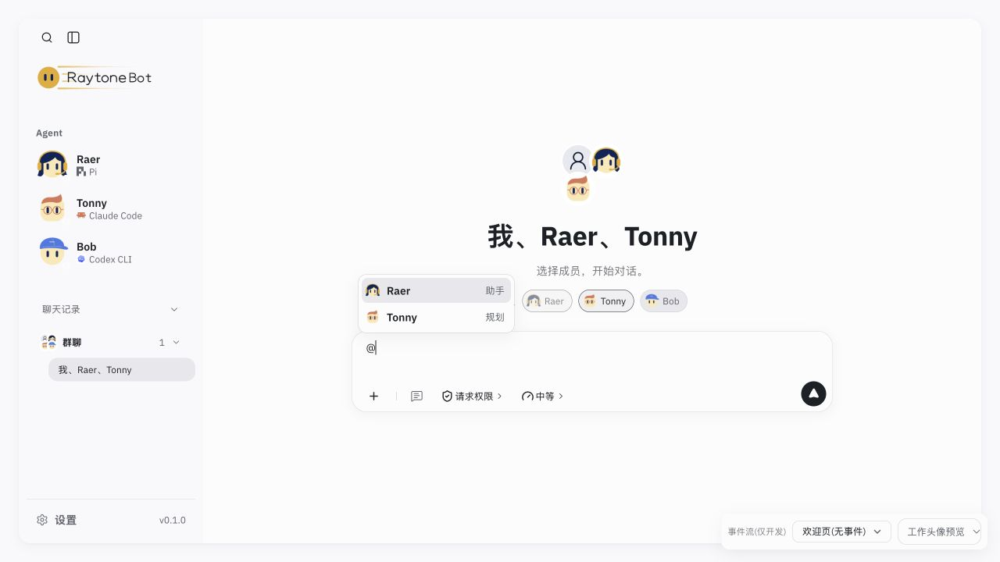
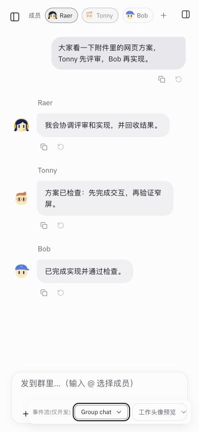

# 群聊成员纯派生提取验收（2026-10-31）

基线：`34a7f71`。快速子代理（gpt-6-luna）实现，主代理独立 review、完整验证与提交。

## 改动与 review

- `src/agent-shell.tsx` 1,915 → 1,905 行；`src/runtime/groupConversationView.ts` 16 行，迁出 `groupFields`、`groupMembersOf`。
- 两个函数体与基线 AST 打印结果一致；26 个保留函数、34 处 effect/memo/callback 调用逐字一致，见 [review.json](review.json)。生产代码差异仅新增 import 和删除原本地函数声明。
- 会话恢复、成员更新、发送与流式状态机、JSX 原位保留。标题、预览、头像派生仍依赖 shell 内的 Bot 身份解析，本批不扩大其接口。
- 4 个新增测试保护元数据 `false` 与缺省值的差别、显式 `undefined` 清除旧字段、Bot ID 过滤、顺序与重复、默认成员回退。未改变原对象引用或输入数据。

## 命令验证

| 命令 | 结果 | 日志 |
| --- | --- | --- |
| `npm run build` | 通过；保留原有大 chunk 提示 | [build.log](build.log) |
| `npm test` | 默认并发 646/646，无失败/跳过 | [tests.log](tests.log) |
| `RAYTONEBOT_URL=http://127.0.0.1:5196 npm run check:local` | UI、SDK、12 tools、空提示校验、跨源拒绝通过 | [check-local.log](check-local.log) |
| `node scripts/cloud-preview.mjs --check` | 认证、host/origin、CSRF、可信归一化、handoff 检查通过 | [cloud-check.log](cloud-check.log) |

使用独立临时 `RAYTONEBOT_DATA_DIR` 和 `RAYTONEBOT_WORKSPACE_ROOT`，本机服务端口 5196；不使用产品会话数据，不调用模型。验证结束后关闭自建浏览器页、恢复视口并停止测试服务，删除临时数据。

## 浏览器验证

真实 IAB 浏览器操作，经既有成员 UI 调用实际本机接口：

1. 选择 Tonny，通过开发场景显示聊天头部，邀请 Raer；头部已选成员与 `@` 列表同步显示 Raer、Tonny。
2. 返回无事件欢迎页，在真实空群聊中添加 Bob，再移除 Bob；群标题、成员选中状态与 `@` 列表同步恢复 Raer、Tonny。
3. 刷新页面仍显示 Raer、Tonny，Bob 未选中。临时存储中 `group.hostId` 为 `planner`，成员为 `assistant`、`planner`，事件数为 0；开发 fixture 正文未写入会话。
4. 在 390 × 844 视口逐项切换全部 20 个开发场景（含无事件欢迎页）；19 个事件场景均挂载聊天框，所有场景页面宽度为 390，无横向溢出。状态快照见 [browser-results.json](browser-results.json)。
5. 本轮控制台 warn/error 为 0。没有运行真实模型，开发事件展示不能代替真实模型流式验收；没有线上部署。

## 本批范围外的已有问题

Tonny 是实际群主时，欢迎页禁用了首位 Raer，Tonny 按钮却可点击；点击后 Tonny 仍保留。代码核对：`GroupWelcome` 不向 `GroupHeader` 传递 `hostId`，因此默认取 `members[0]`；服务端 `groupChat.setGroupMembers` 则拒绝移除实际群主。上述组件、服务端及 shell 调用与基线相同，本批不修复此行为差异；已记录到路线图待后续处理。

验证中一次尝试点击欢迎页会话列表时，该列表尚未显示，定位超时；重新观察确认群聊已直接在欢迎页显示。随后按当前界面继续，未将定位失败计为产品回归。
