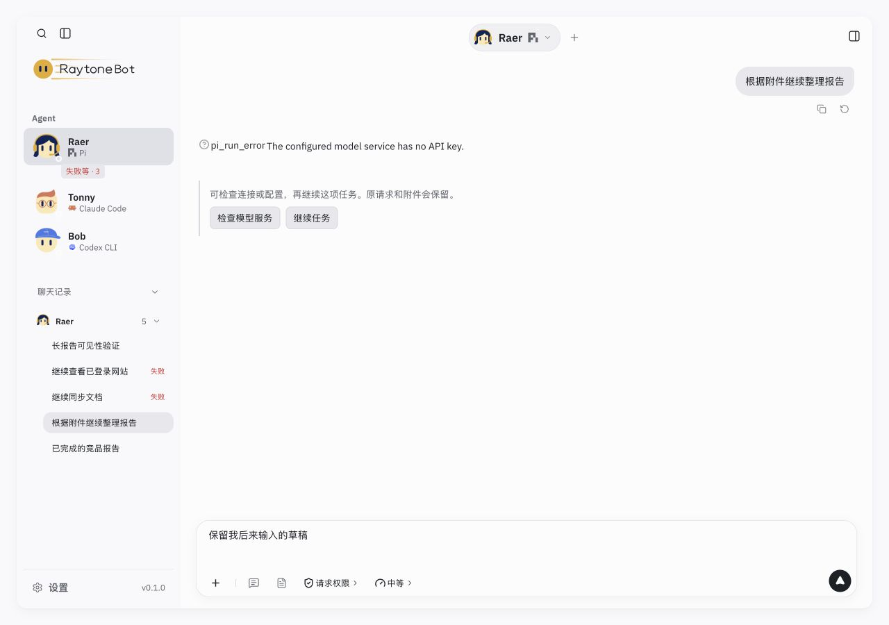
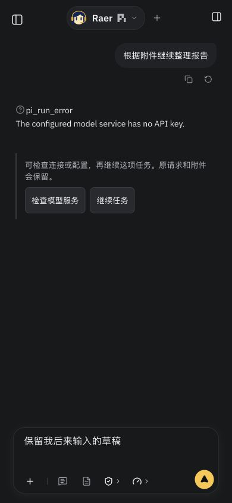

# T6.8 配置续接与任务交付提示验收

2026-10-29。对应竞品复评的优先级 1–2，使用当前应用、HTTP 主机与会话/任务文件存储，配合本地受控引擎和虚构数据。未连接真实模型、MCP 服务、登录账号或部署。

## 结果

- 模型服务、MCP、Vault、浏览器登录相关错误沿原 ChatFrame 提供检查入口。返回后显式继续；原请求、附件和聊天引用从原提交恢复，后来编辑的草稿保留。主机运行中、缺终态或出现新进展时拒绝继续旧请求。
- 同一来源的继续请求复用稳定请求身份，前端同步加锁并沿主机接受记录去重。真实点击双击按钮后只接受一轮继续，原文件引用完全一致；见 [存储核对](recovery-verification.json)、[引擎收到的提交](calls.json)。已有审批仍通过原链路确认。
- 侧栏聊天行与 Bot 状态显示新结果、失败、需要用户处理；点击回到来源。长报告定位到开头时保留新结果提示，滚动到末尾才清除；刷新后已读保留。审批未解决时查看会话不会清除“需要你”。
- 例行任务保存最近一次未运行的时间与原因。重启错过及并发占用均不自动补跑，不把占用计为执行失败；Bot 入口直接展开对应任务，详情可见后清除未查看提示。重启中断也保留可发现入口。

## 检查

| 检查 | 实际结果 |
| --- | --- |
| `node --test src/runtime/taskRecovery.test.ts src/runtime/conversationActivity.test.ts src/pi/routines.test.ts src/pi/conversationStore.test.ts` | 32/32 通过；最后的兼容语法修改后，配置路由 3/3 再次通过 |
| `npm test` | 607/607 通过，无失败/跳过；[完整输出](tests-final.log) |
| `npm run build` | 通过；保留既有 Vite 导入后缀及大包警告，见 [输出](build.log) |
| `RAYTONEBOT_URL=http://127.0.0.1:5195 npm run check:local` | UI、真实 Pi SDK、12 个工具、空请求与跨源拒绝通过；独立临时数据，不调用模型 |
| `node scripts/cloud-preview.mjs --check` | 认证、主机/origin、CSRF、归一化与接管会话检查通过 |
| 浏览器内置场景 | 20 个逐项切换，涵盖 reasoning、工具/审批、错误/重试/终态、打断、产物及欢迎页；桌面宽度 1280，scrollWidth 均为 1280，见 [逐项状态](fixtures.json) |
| 实际交互 | 配置打开/返回、双击继续、附件/后续草稿、审批切走/返回/确认、长结果可见性、刷新已读、漏跑来源展开均通过 |
| 响应式 | 1280×900 桌面、390×844 窄屏浅深色；无横向溢出，窄屏恢复动作高度 44px；未替代真实手机验收 |

先观察失败再修复的回归包括：摘要缺少最新结果、任务重启未记录错过、并发已满误判重复场次、MCP 401 被送往模型设置。工具路由测试使用实际 Pi 适配器产生的错误事件，覆盖内部浏览器工具名称归一化。

## 最终效果

以下均为应用实拍及测试数据。

其他证据：[继续后完成及保留草稿](final-completed.jpg)、[登录复用右侧浏览器](login-recovery.jpg)、[需要你与原审批](needs-you.jpg)、[最终漏跑说明](final-routine.jpg)、[长结果尚未读完](unread-long-result.jpg)。最后一次页面检查无浏览器 error，见 [状态](browser-final.json)；新增文档的本地链接和 `git diff --check` 通过。

## 复现与边界

`RAYTONEBOT_ENABLE_TEST_ENGINE=1 node output/task-flow-2026-10-29/serve.mjs` 在 5194 启动隔离演示，每次使用新临时目录；保留应用原 HTTP/存储，仅替换引擎，不属于新增产品服务。2026-10-30 补充：必须显式启用测试引擎，页面常驻演示提示并拒绝保存模型密钥；验收结束关闭演示入口。真实本地服务使用 `npm run dev` 的 5188。独立真实 SDK 接口检查使用 5195。测试服务不接触用户原数据。

错误识别基于有限的错误事件与工具身份，第三方自定义文案可能仍需手动打开设置。继续已接受任务会发起核对进展的新轮次；不能凭 UI 去重保证外部服务恰好执行一次，状态不明仍需核对。附件保留路径引用，不创建历史文件快照。

已读身份仅保存在当前浏览器并同步同源标签页，不跨设备；清除浏览器数据后可重新出现。例行任务只记录最近一次跳过，旧任务首次检查前的历史不追溯；主机睡眠时不会运行，提醒只在应用可见并取得状态后更新，无系统推送。真实模型续接质量、真实登录/服务和线上环境仍待专项验收。
